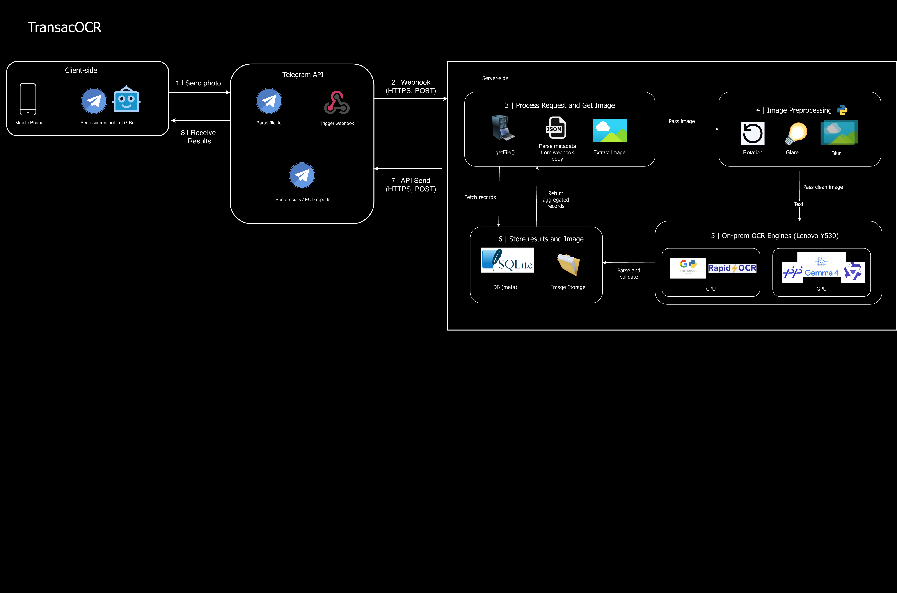

# TransacOCR
OCR Telegram Bot for reading and logging captured photos of e-wallet/bank transactions.

Allowlisted Submitters post receipt screenshots in an Allowed group. The bot acknowledges at once, reads the Receipt
(RapidOCR finds the text rows, glm-ocr via Ollama reads each row), parses it per Provider, stores the row and the original
image, and replies with the extracted fields. At 22:00 Asia/Manila it posts an end-of-day report with a CSV.
Terms are defined in [GLOSSARY.md](GLOSSARY.md); the reasoning behind non-obvious choices is in [docs/adr/](docs/adr/).

## Architecture



_Diagram to be added at `docs/images/architecture.png`._ Flow: Telegram long polling → handlers (allowlist, instant ack, save the original image) → single FIFO worker → recogniser (RapidOCR boxes, glm-ocr per row) → per-Provider parser and validation → SQLite → reply. A daily job on the same event loop builds the end-of-day report and CSV.

## Run

```bash
python -m venv .venv && . .venv/bin/activate
pip install -r bot/requirements.txt -r ocr/requirements.txt
ollama pull glm-ocr:q8_0            # only needed for RECOGNISER=glm
```

Set these in the environment or in a `.env` file in the repo root (loaded on startup, and git-ignored):

| Variable | Meaning | Default |
| --- | --- | --- |
| `BOT_TOKEN` | Bot token from BotFather (required) | |
| `ALLOWED_CHAT_IDS` | Comma-separated Allowed group chat IDs | none (bot stays silent) |
| `ALLOWED_USER_IDS` | Comma-separated Telegram user IDs of Submitters | none |
| `STORAGE_DIR` | Where original images are saved (`<YYYY-MM>/<file_unique_id>.<ext>`). Relative paths resolve against the folder you start the bot from. | `./images` |
| `DB_PATH` | SQLite file | `./transacocr.db` |
| `RECOGNISER` | `glm` (RapidOCR boxes + glm-ocr per row) or `rapid` (RapidOCR text only) | `glm` |
| `EOD_TIME` / `TZ_NAME` | End-of-day report time and zone | `22:00` / `Asia/Manila` |

In BotFather, turn **privacy mode off** for the bot (`/setprivacy` → Disable), or it will not see photos in groups.

```bash
python -m bot.main          # long polling, no public URL needed
```

Commands in an Allowed group: `/start` (greeting), `/report [YYYY-MM-DD]` (the end-of-day report for a day, default today).

## Develop

```bash
pytest -q                                              # unit tests
python eval/dump_items.py rapid                        # cache recogniser output for images/train (or: glm)
python eval/score.py eval/cache/rapid                  # per-field, per-Provider accuracy vs labels/train.csv
python eval/score.py eval/cache/rapid --show reference GCash   # list the misses
```
